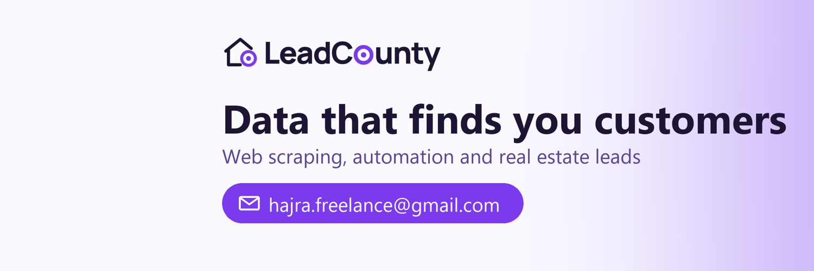

### Hi, I'm Hajra Wajid........ and yes, I'm a developer.....

I turn messy websites into clean data. Then I make that data do something useful.

Most of my work starts the same way. A client sends a link and says *"can you just get everything from this site?"* Sometimes it's 18,000 UK government contracts. Sometimes it's every one of the 498,409 parcels in a US county. I've delivered more than 130 million records like that, on Upwork, on Fiverr and for direct clients.

These days I also run **[LeadCounty](https://leadcounty.com)**. It takes public county records (owners, taxes, sales, court filings) and scores every property on how likely the owner is to sell. 101 counties, 27 states so far.

#### What I actually work with
Python, Playwright, Scrapy, Selenium, FastAPI, pandas, DuckDB, n8n, Docker, and LLMs when they really help.

        

#### How I scrape
Front door first: an API, an export button, a bulk file. I go slow on purpose. I only re-download pages that changed. And I don't break locks (no CAPTCHA solving, no logins that aren't mine)....... it has cost me a few jobs, and I'd do it again.

#### Watch the projects
I recorded short walkthroughs of real jobs: government tenders, patents, metal prices, employee reviews, and a lot of US county property data.
👉 **[hajra-wajid.github.io/portfolio](https://hajra-wajid.github.io/portfolio/)**

#### I write about this
**[Data Behind the Deal](https://www.linkedin.com/newsletters/7521914552037474304/)**, my LinkedIn newsletter on real estate data, scraping and AI. Twice a week.

#### Say hi
[LinkedIn](https://www.linkedin.com/in/hajra-wajid) · [X](https://x.com/HajraWajidDev) · [TikTok](https://www.tiktok.com/@hajrawajiddev) · [BiggerPockets](https://www.biggerpockets.com/users/hajraw) · [Upwork](https://www.upwork.com/freelancers/~017419bb1687a8a9e6) · [Portfolio](https://hajra-wajid.github.io/portfolio/) · hajra.freelance@gmail.com

LeadCounty: [Website](https://leadcounty.com) · [LinkedIn](https://www.linkedin.com/company/145392018/) · [Facebook](https://www.facebook.com/leadcounty) · [Crunchbase](https://www.crunchbase.com/organization/leadcounty) · [SourceForge](https://sourceforge.net/software/product/LeadCounty/) · [SaaSHub](https://www.saashub.com/leadcounty)
